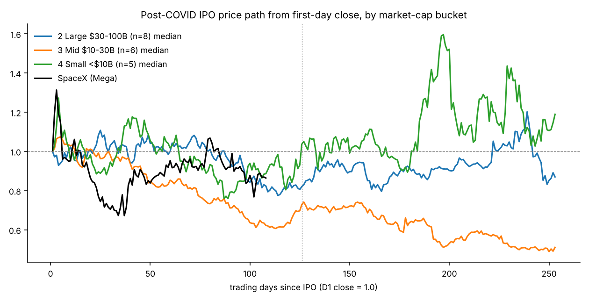
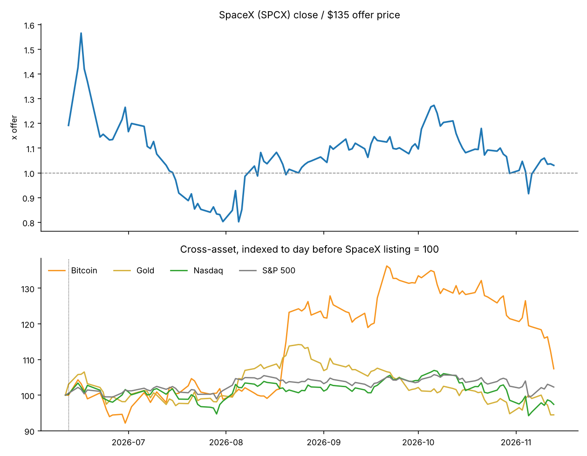
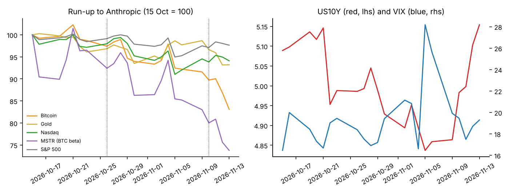

# IPO frenzy → reversion study, and what it implies for Anthropic (ANT)

*As of 15 Nov 2026 (market data to the 13 Nov close). Reproduce with `python3 ipo_study/ipo_cohort.py` and `python3 ipo_study/liquidity_panel.py`. Not investment advice.*

## Bottom line

1. **The hypothesis is only partly right.** The frenzy is real (median first-day pop +34%), but the reversion is not mostly a first-weeks event. From the first-day close, the median post-COVID IPO is +6% at day 5, −4% at day 21 and **−19.5% at day 126 (about 6 months)**. 63% sit below their day-1 close at six months. Reversion is a 1–6 month process that peaks around lock-up and earnings unlocks.
2. **Market cap matters, but the cap buckets are thin.** Mid caps ($10–30B) were the worst (median −51% from day 1 at 12 months). Small caps (<$10B) are bimodal: the AI/crypto "scarcity" names kept running (Reddit, Astera, Circle) while the others bled. **Every mega-cap (≥$100B) IPO I can test reverted within 21 days**: SpaceX −15%, Facebook −18%, Alibaba −6%; Facebook and Alibaba ended 12 months at −33% and −30% from their day-1 close. That is n=3, so it is a pattern to respect, not a law.
3. **SpaceX (listed 12 Jun 2026) is the best template, and it followed your script closely.** Offer $135, day-1 close $160.95 (+19%), peak close $211.39 on day 3 (+57%; intraday high $225.64), back below the offer by day 23 (16 Jul), trough close $108.27 on day 37 (−20% vs offer, −49% from the peak), now $139 (+3%).
4. **Liquidity drain: visible in risk assets, not in Fed plumbing.** Before both SpaceX and Anthropic, Bitcoin, MSTR, gold and the AI complex fell while the S&P held up (table below). Fed net liquidity did *not* fall; it rose about $43B over the Anthropic run-up as the Treasury General Account (TGA) was drawn down. VIX barely moved (about 19). That points to a quiet funding rotation, not a forced-deleveraging event. Rising yields and the dollar explain the moves just as well, and I can't separate the two.
5. **My read for ANT (judgment, not a model output):** a frenzy window in days 1–5 is likely, and the fade risk is highest from about day 5 to day 63. The setup is closer to SpaceX than to a typical IPO: a tiny float (about 4.5%), an enormous deal ($58–64B), and a hostile macro backdrop (10-year yield 5.15%, AI-spending worries, weak Q3 IPO tape).

## 1. Cohort evidence (post-COVID, underwritten IPOs, n=20)

Returns are measured **from the day-1 close**, since that is what a buyer in the frenzy pays. `D` is the trading day counted from the IPO date.

| Cut | n | Day-1 pop (median) | D5 | D21 | D63 | D126 | D252 |
|---|---|---|---|---|---|---|---|
| All post-COVID | 20 | +34% | +6% | −4% | 0% | **−20%** | −1% |
| Share below day-1 close | | | | 55% | 50% | 63% | 50% |
| Small <$10B | 5 | +48% | +15% | −6% | +8% | +4% | +15% |
| Mid $10–30B | 6 | +19% | +8% | +1% | −15% | −27% | **−51%** |
| Large $30–100B | 8 | +41% | −6% | −1% | +4% | −18% | −11% |
| Mega ≥$100B | 1 (SpaceX) | +19% | +15% | −16% | −6% | – | – |
| *Pre-COVID reference* (FB, BABA mega; UBER large) | 3 | +1/+38/−8% | −14/−5/+3%  | −18/−6/+3% | −48/+16/+3% | −38/−9/−35% | −33/−30/−21% |

**By first-day pop** (a cleaner cut than cap given the sample size):

| Day-1 pop | n | D5 | D21 | D63 | D126 | D252 |
|---|---|---|---|---|---|---|
| <15% | 6 | +7% | +1% | −8% | −23% | −22% |
| 15–40% (SpaceX is here) | 5 | **+15%** | **−15%** | −6% | +9% | +22% |
| >40% | 9 | −5% | −4% | +8% | −12% | +6% |

- The cleanest "frenzy, then profit-taking" signature is the **moderate-pop group (15–40%)**: +15% over the next four days, then −15% by day 21. Huge pops (>40%) don't fade early; the buyers at the offer price are sitting on enough cushion to hold.
- A bigger day-1 pop correlates with returns *from the offer price* (Spearman +0.4 to +0.5) but **not** with returns from the day-1 close (about 0). Allocation at the offer is where the money is made, and the open is not.
- Q3 2026 IPO class (Renaissance): average first-day +6.2%, aftermarket −5.7%, **30% priced below range** (a recent high), 39% negative on day 1, and the ten largest deals averaged −6% from offer. Two deals were pulled (Oura, Holtec). The IPO index fell 11.5% in the quarter. The tape into Anthropic is *colder* than into SpaceX.

**Caveats.** The cohort is hand-picked notable US listings (selection bias). Market caps at offer are approximate. Direct listings (Coinbase, Roblox, Palantir) and the SK hynix ADR (a cross-listing, not a price-discovered IPO) are excluded. Medians on n=5–8 are noisy. The proper upgrade is to run the same code on the full Ritter / Renaissance universe.

## 2. SpaceX as the analog

| | SpaceX | Anthropic (reported) |
|---|---|---|
| Pricing | Fixed $135 | **Range $70–78**, 825M shares (incl. some secondary), price 18 Nov, trade 19 Nov |
| Gross proceeds | $75B (up to $86B with greenshoe) | ≈ **$57.8–64.4B** |
| Float sold | ≈4.2% (4.8% with greenshoe) | ≈4.4–4.6% (my estimate from third-party implied values of $1.33–1.40T) |
| Valuation vs sales | ≈39x forward sales | ≈16–17x run-rate revenue (≈$81B run-rate per the S-1) |
| Unlock design | Earnings-linked: ~20% (Aug), ~28% (Oct), ~17% (8 Dec); first big unlock came ~8 weeks in | Up to 10% early; then 180 days or Q1-27 results; founders and >0.5% holders 365 days or Q3-27 results; >20 windows over a year |
| Frenzy drivers | Retail, options, anticipated index buying | Likely the same set, plus Nasdaq-100 inclusion demand (SpaceX fell ~13% *after* it was added) |

Takeaways: SpaceX rolled over *before* its first big unlock (below offer on day 23), so the unlock schedule is not the only driver. The lock-up is staggered for Anthropic, so a single "cliff" is less likely, but the first sizable windows would still land around 6 months out. The bear case for Anthropic is that the frenzy window is brief and the market then re-prices the AI-spend narrative.

## 3. Liquidity, de-leveraging and cross-asset behaviour

Change over each window (equities, gold, BTC in %; VIX and yield in points; liquidity in $B):

| Window | S&P | Nasdaq | NVDA | Gold | BTC | MSTR | VIX | US10Y | DXY | Net liq ($B) |
|---|---|---|---|---|---|---|---|---|---|---|
| SpaceX: 14d before listing | −0.7 | −1.8 | −6.6 | **−9.4** | **−18.0** | **−27.1** | +2.7 | −0.1 | +0.7 | −32 |
| SpaceX: listing → T+3 (frenzy) | +0.3 | +0.8 | −0.1 | +6.5 | +1.3 | −3.0 | −1.0 | 0.0 | +0.2 | −48 |
| SpaceX: T+3 → T+21 (fade) | +2.1 | +1.0 | +3.8 | −7.5 | +0.5 | −16.4 | −2.8 | +0.1 | +0.4 | +138 |
| SpaceX: T−1 → T+63 | +3.1 | +1.5 | +3.1 | +5.8 | **+23.0** | +14.0 | −2.3 | +0.5 | −0.4 | −41 |
| **Anthropic: 26 Oct S-1 → 13 Nov** | −1.5 | −3.9 | **−24.6** | −3.8 | **−14.7** | **−20.2** | +0.9 | +0.2 | +1.4 | **+43** |
| Anthropic: last 5 days | +2.5 | +2.3 | −12.7 | −4.6 | −9.9 | −13.4 | −6.3 | +0.3 | +1.1 | +53 |

(BTC has since fallen further: about $64.2k on 15 Nov vs about $74k on 11 Nov.)

**Observations**

- **Same fingerprint in both run-ups.** The speculative-liquid assets (BTC, MSTR, gold, AI/semis) are sold while the broad S&P holds. That is consistent with funds and retail raising cash, or cutting other risk, to fund an allocation of roughly $60–85B of new supply. Supply stacking: SpaceX $75–86B + SK hynix $26.5B + Anthropic ≈$58–64B is about **$160–177B in five months**, against $104.8B for all of Q2 (which already included SpaceX).
- **The official plumbing says otherwise.** Net liquidity (Fed balance sheet − TGA − reverse repo) was flat to rising into Anthropic, driven by a TGA drawdown. The drain is in *private risk budgets*, not reserves.
- **It is not a VIX/margin-call event.** VIX is about 19 and moved less than a point over the run-up. This looks like de-grossing, not forced selling, though I did not pull margin debt (FINRA) or fund-flow data (gap).
- **Confound.** Yields (10-year at 5.15%, a multi-year high, with rate hikes resumed per Renaissance) and the dollar (+1.4%) also explain falling gold and BTC. NVDA's −25% is an AI-spend story as much as an IPO-funding one. With n=2 events I cannot attribute causality.
- **Post-listing relief (n=1).** After SpaceX listed, BTC rose 23% and gold 6% by T+63; the pressure lifted once the supply was absorbed. If that repeats, a bounce in BTC/MSTR/gold shortly after the 18–19 Nov pricing would be the "supply cleared" tell.

## 4. Scenarios for ANT (my judgment, calibrated loosely on the analogs, not a forecast)

| Scenario | Rough odds | Shape | Analog |
|---|---|---|---|
| **Base: SpaceX-lite** | ~50% | Day-1 +15–35%; peak in days 2–5 at +30–55% vs offer; −10–20% from day-1 close by D21; near the offer by D63 | SpaceX |
| **Bull: scarcity premium holds** | ~25% | Prices at or above range, pop >40%, holds well above offer through 3 months as low float and index demand dominate | Reddit, Circle, CoreWeave (smaller caps, remember) |
| **Bear: macro overrides** | ~25% | Pop <10%, below offer within ~3 weeks, −20–30% at D63 | Facebook 2012, Rivian, Q3-26 class |

Triggers to watch: the pricing vs the $70–78 range (above range = strong book; at or below = weak); day-1 volume and options activity; the 10-year yield (5.15% now), NVDA and BTC after pricing; any Nasdaq-100 inclusion date; and the first unlock windows.

## 5. Data caveats and next steps

- Several Anthropic numbers (price range, share count, lock-up terms, run-rate, 9-month results) come from secondary summaries that restate the S-1/A (Leverage Shares, tastytrade, Secfi) and I did not read the SEC filing itself; implied valuations ($1.33T WSJ, $1.404T TechCrunch) are third-party estimates. **Verify against the S-1/A before relying on them.** Offer-price sources for SpaceX conflicted ($135 vs ~$150); I used $135 (Reuters, Investopedia, Wikipedia), which also reconciles with the day-1 pop.
- Next steps, in value order: (a) replace the hand-picked cohort with the full Ritter / Renaissance universe and re-bucket by market cap, float % and day-1 pop; (b) add margin debt, ETF/fund flows and retail-options volumes to the liquidity panel; (c) add day-by-day post-listing tracking of ANT against this template; (d) fit the pop → fade relation on float-adjusted size.

## Appendix: reusable research prompt

> Study US IPOs since Sep 2020 by market-cap bucket (<$10B, $10–30B, $30–100B, ≥$100B at offer). For each IPO compute returns from the offer and from the day-1 close at D1/3/5/10/21/63/126/252, peak day, days to first close below offer, and excess return vs the S&P 500. Test the hypothesis "frenzy in days 1–5, profit-taking and mean reversion over weeks to months", report medians with n, and flag small samples. Then take [target IPO]: compare float %, proceeds, valuation/sales and lock-up design to the closest analogs, and build a cross-asset panel (S&P, Nasdaq, VIX, gold, BTC, US10Y, DXY, Fed net liquidity = WALCL − TGA − ON RRP) for the pre-listing run-up, listing week and T+21/T+63 windows of each analog mega-IPO. Separate "liquidity drain" from rates/dollar confounds, state what cannot be identified, and give bull/base/bear scenarios with explicit triggers.
